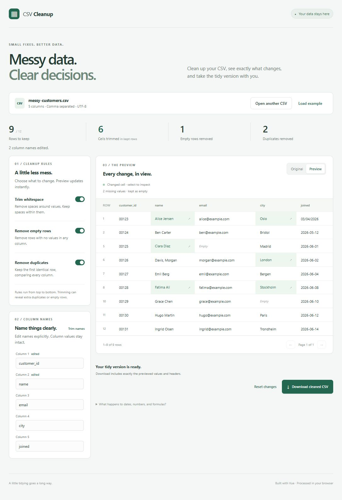

# CSV Cleanup Previewer

A small Vue app for turning a messy CSV into a reviewed, downloadable result. Choose a cleanup rule, inspect the preview, and export exactly the values you see.



## Run locally

Requires Node.js **24.12 or newer** and npm.

```sh
git clone https://github.com/vegardknudsen/csv-cleanup-previewer.git
cd csv-cleanup-previewer
npm ci
npm run dev
```

Open the URL printed by Vite, then select **Try an example** or choose a UTF-8 `.csv` file.

```sh
npm test            # Regression tests and Vue interaction test
npm run build      # Type-check and production build
npm run preview    # Serve the production build locally
```

## What you can do

- Trim leading and trailing whitespace while preserving internal spaces.
- Remove completely empty rows.
- Remove duplicate rows, keeping the first occurrence.
- Edit column names by position, including blank or duplicate names.
- Compare the original with the cleanup preview, inspect changed cells, and review rows marked for removal.
- Reset every change and download a new CSV.

The included [fictional customer list](src/samples/messy-customers.csv) has 12 data rows. Enabling all three rules keeps **9 rows**, trims **6 cells in retained rows**, removes **1 empty row**, and removes **2 duplicates**. **Trim names** cleans two headers. See [the expected export](docs/example.cleaned.csv).

## How cleanup works

The original document remains unchanged. Each settings change recomputes the preview from it:

1. Apply explicit header edits.
2. Trim whitespace if selected.
3. Remove empty rows if selected.
4. Remove duplicates if selected.

Duplicate comparison is case-sensitive and includes every column after the preceding rules. Whitespace-only rows are empty only when trimming is enabled. Row IDs refer to the original data records, excluding the header; they are not physical line numbers because quoted cells can contain line breaks.

Changed-cell counts describe retained rows. Removed rows have one reason: empty or duplicate. Missing values are highlighted but never filled. Blank and duplicate column names produce warnings and remain exportable until you choose replacements.

## Data handling and limits

- Files are processed in browser memory. There are no uploads, analytics, remote fonts, accounts, or API calls.
- Refreshing or closing the page clears the current file. A failed import keeps the previous file open.
- UTF-8 CSV only; 5 MiB maximum, 100,000 cells including headers, and 200 columns.
- The first record is always the header. Supported detected separators: comma, semicolon, tab, and pipe.
- Unequal field counts are rejected with a record number. Physical blank lines become empty records; a final line ending does not create an extra row.
- Values remain strings: leading zeroes, date-like values, and formula-like values are preserved.
- Export retains the detected separator and record line ending, quotes every field, and normalizes CSV syntax. It preserves values, not the original file's exact bytes or quoting style.
- Spreadsheet software can still interpret CSV text as numbers, dates, or formulas. Import columns as text when that interpretation matters, and only open data you trust.

Parsing and cleanup run on the main thread within the limits above. This is a small-file tool, not a streaming processor for large datasets. Headerless input, Excel workbooks, automatic date conversion, and inferred missing values are outside version one.

## Code map

| Location                           | Responsibility                                               |
| ---------------------------------- | ------------------------------------------------------------ |
| `src/core/parseCsv.ts`             | UTF-8 import, delimiter detection, shape validation, limits  |
| `src/core/rules/`                  | Small, independent cleanup rules                             |
| `src/core/cleanCsv.ts`             | Immutable pipeline, change tracking, header warnings         |
| `src/core/exportCsv.ts`            | CSV serialization and browser download                       |
| `src/composables/useCsvCleanup.ts` | Reactive Vue state and import lifecycle                      |
| `src/components/`                  | Import, controls, header editor, summary, table, export      |
| `tests/`                           | Parser, pipeline, round-trip, and interactive workflow tests |

Built with [Vue](https://vuejs.org/), TypeScript, [Papa Parse](https://www.papaparse.com/docs), Vite, and Vitest. GitHub Actions runs tests and the production build on pushes to `main` and pull requests. There is no automatic deployment.

## AI-assisted development

This project was planned and implemented with Codex. [AI_WORKFLOW.md](AI_WORKFLOW.md) records the scope, design decisions, and validation performed. It distinguishes generated implementation from maintainer review.
